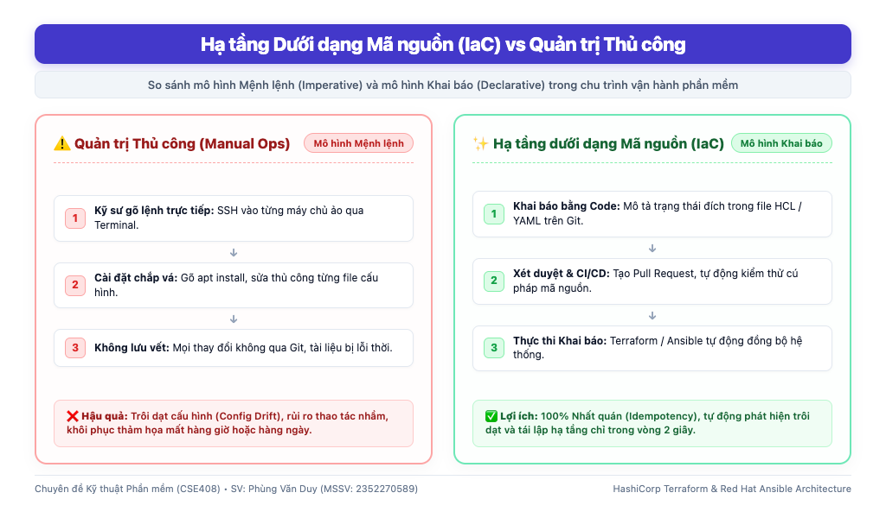
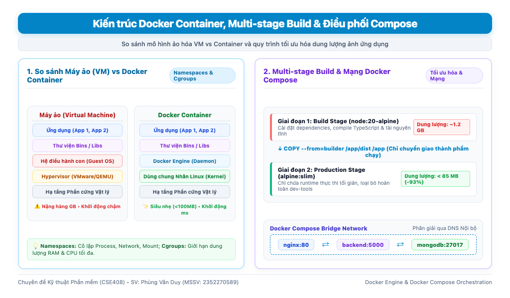
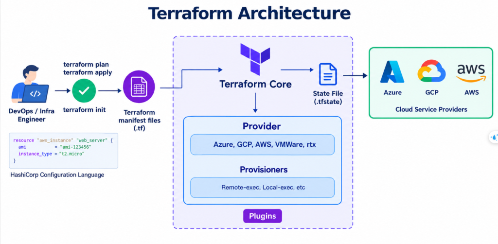
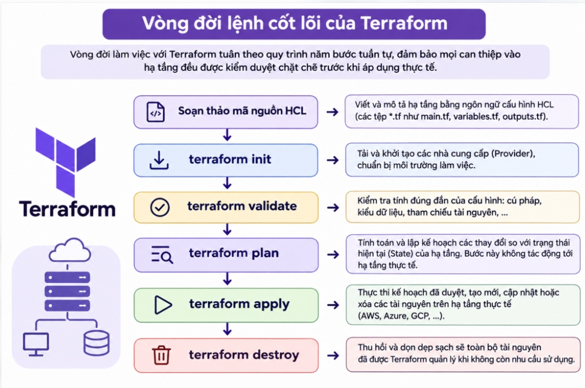
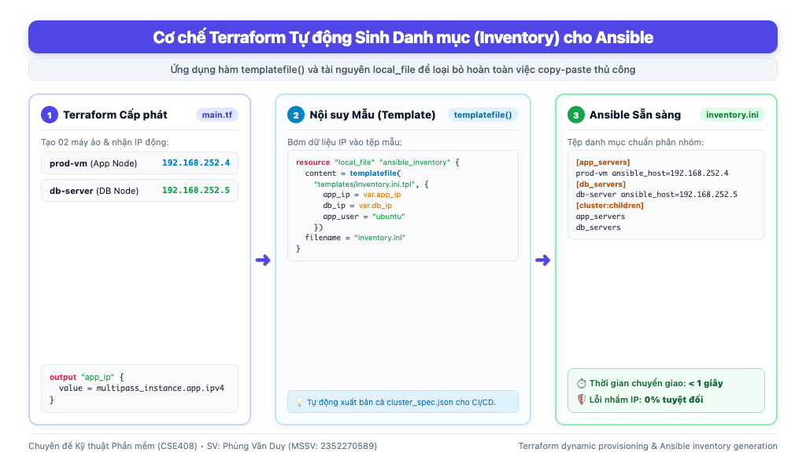
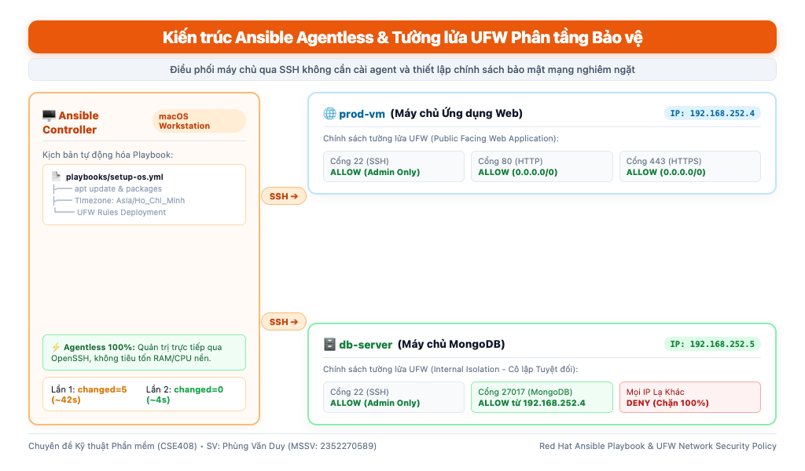

# BÁO CÁO TỔNG KẾT TIẾN ĐỘ THỰC HIỆN ĐỀ TÀI (PHẦN 01 ĐẾN PHẦN 05)

- **Học phần:** Chuyên đề Kỹ thuật Phần mềm (CSE408)
- **Đề tài:** Tìm hiểu quy trình tự động hóa hạ tầng và CI/CD với Docker dựa trên Terraform và Ansible
- **Sinh viên thực hiện:** Phùng Văn Duy – **MSSV:** 2352270589
- **Giảng viên hướng dẫn:** ThS. Nguyễn Thọ Thông
- **Học kỳ:** Học kỳ 7 – Năm học 2026-2027

---

## 📑 MỤC LỤC BÁO CÁO

1. [TỔNG QUAN ĐỀ TÀI & LÝ   DO CHỌN ĐỀ TÀI (WHAT & WHY)](#1-tổng-quan-đề-tài--lý-do-chọn-đề-tài-what--why)
2. [CHI TIẾT NỘI DUNG TÌM HIỂU & KIẾN THỨC CỐT LÕI (PHẦN 01 - 05)](#2-chi-tiết-nội-dung-tìm-hiểu--kiến-thức-cốt-lõi-phần-01---05)
3. [BẢNG TỔNG HỢP CHUỖI CÔNG NGHỆ & ĐỐI CHIẾU THỰC NGHIỆM](#3-bảng-tổng-hợp-chuỗi-công-nghệ--đối-chiếu-thực-nghiệm)
4. [ĐÁNH GIÁ KẾT QUẢ ĐẠT ĐƯỢC & KẾ HOẠCH TRIỂN KHAI TIẾP THEO (PHẦN 06 - 10)](#4-đánh-giá-kết-quả-đạt-được--kế-hoạch-triển-khai-tiếp-theo-phần-06---10)

---

# 1. TỔNG QUAN ĐỀ TÀI & LÝ DO CHỌN ĐỀ TÀI

## 1.1. Đề tài này là gì

Đề tài **"Tìm hiểu quy trình tự động hóa hạ tầng và CI/CD với Docker dựa trên Terraform và Ansible"** là một công trình nghiên cứu và hiện thực hóa quy trình kỹ thuật phần mềm hiện đại nhằm tự động hóa hoàn toàn vòng đời của một hệ thống ứng dụng từ con số 0:

- **Khởi tạo tài nguyên hạ tầng (Provisioning):** Tự động cấp phát máy chủ ảo, bộ nhớ, vi xử lý và cấu hình mạng thông qua mã nguồn khai báo.
- **Quản lý cấu hình & Bảo mật (Configuration Management):** Tự động chuẩn hóa hệ điều hành, phân quyền người dùng, cấu hình tường lửa và cài đặt môi trường thực thi mà không cần can thiệp thủ công.
- **Đóng gói ứng dụng (Containerization):** Cô lập mã nguồn ứng dụng và các thư viện phụ thuộc vào các khối container đồng nhất, loại bỏ lỗi tương thích môi trường.
- **Đường ống Tích hợp & Triển khai liên tục (CI/CD Pipeline):** Tự động hóa kiểm thử mã nguồn, đóng gói bản phát hành và kích hoạt cập nhật lên máy chủ ngay khi lập trình viên đẩy mã nguồn lên Git (`git push`).

**Mục tiêu đích của đề tài:** Xây dựng một chuỗi tự động hóa khép kín, biến toàn bộ hệ thống thành mã nguồn (**Everything as Code**), cho phép tái lập 100% một hệ thống máy chủ hoàn chỉnh chỉ bằng **1 dòng lệnh** hoặc **1 thao tác Git**.

---

## 1.2. Tại sao lại chọn đề tài này

### a) Thực trạng và hạn chế nghiêm trọng của quản trị hạ tầng truyền thống

Trong phát triển phần mềm truyền thống, công việc vận hành máy chủ (SysAdmin/Ops) phụ thuộc nặng nề vào các thao tác thủ công (gõ lệnh trực tiếp trên terminal, mở giao diện đồ họa bấm chuột). Cách làm này bộc lộ 4 điểm nghẽn chí tử:

1. **Trôi dạt cấu hình:** Theo thời gian, môi trường phát triển (Local), kiểm thử (Staging) và chạy thật (Production) bị lệch nhau do các bản vá lỗi chắp vá bằng tay. Đây là nguồn cơn của câu nói kinh điển gây nhức nhối trong ngành phần mềm: _"Chạy trên máy tôi vẫn bình thường, sao lên máy chủ lại lỗi?"_.
2. **Tốc độ triển khai chậm chạp:** Khi cần mở rộng thêm máy chủ hoặc dựng lại môi trường mới, kỹ sư phải mất hàng giờ, thậm chí nhiều ngày để cài đặt từng gói phần mềm, phân quyền và mở cổng mạng.
3. **Rủi ro sai sót con người (Human Error):** Con người gõ lệnh có thể quên bước, gõ sai một ký tự trong tệp cấu hình hoặc thiết lập sai luật tường lửa, gây sập dịch vụ hoặc tạo lỗ hổng bảo mật nghiêm trọng.
4. **Khả năng khôi phục sau thảm họa (Disaster Recovery) cực kém:** Khi máy chủ gặp sự cố phần cứng hoặc bị tấn công, việc dựng lại phụ thuộc hoàn toàn vào trí nhớ cá nhân hoặc các tệp tài liệu hướng dẫn đã lỗi thời từ lâu.

### b) Tính cấp thiết và xu hướng của ngành công nghiệp

- **Văn hóa DevOps & GitOps:** Ngành công nghiệp phần mềm hiện đại đòi hỏi chu kỳ phát hành tính năng tính bằng phút/giờ thay vì bằng tháng. Toàn bộ hạ tầng phải được phiên bản hóa trên Git (Git là Nguồn chân lý duy nhất - Single Source of Truth).
- **Hạ tầng bất biến:** Thay vì sửa chữa một máy chủ đang hỏng, hệ thống tự động tiêu hủy và khởi tạo lại một máy chủ mới toanh đạt chuẩn trong vài giây.

---

## 1.3. Phân vai và phối hợp 4 trụ cột công nghệ

Đề tài lựa chọn bộ tứ công nghệ chuẩn mực nhất hiện nay trong hệ sinh thái mã nguồn mở:

```text
[1. TERRAFORM] ──(Tự động sinh)──> [2. ANSIBLE] ──(Cài đặt)──> [3. DOCKER] ◄── [4. GITHUB ACTIONS]
  Cấp phát máy ảo                   Cấu hình OS                   Đóng gói &      Tự động hóa CI/CD
  & Định danh IP                    & Tường lửa UFW               Chạy App        khi có Git Push
```

| Công cụ                 | Tầng phụ trách                        | Lý do lựa chọn chuyên biệt                                                                                 |
| :---------------------- | :------------------------------------ | :--------------------------------------------------------------------------------------------------------- |
| **HashiCorp Terraform** | Tầng Cấp phát Hạ tầng (Provisioning)  | Quản lý vòng đời phần cứng/máy ảo xuất sắc nhất theo mô hình Khai báo và tệp trạng thái (`.tfstate`).      |
| **Red Hat Ansible**     | Tầng Quản lý Cấu hình (Configuration) | Cấu hình hệ điều hành không cần cài phần mềm đại lý (Agentless qua SSH), nhẹ nhàng, bảo mật và Idempotent. |
| **Docker & Compose**    | Tầng Đóng gói & Thực thi Ứng dụng     | Đóng gói ứng dụng cô lập, chạy đồng nhất 100% trên mọi nền tảng, khởi động trong mili-giây.                |
| **GitHub Actions**      | Tầng Tự động hóa Đường ống (CI/CD)    | Tích hợp sâu vào kho mã nguồn Git, tự động kiểm thử và triển khai không cần duy trì máy chủ CI riêng.      |

---

# 2. CHI TIẾT NỘI DUNG TÌM HIỂU & KIẾN THỨC CỐT LÕI (PHẦN 01 - 05)

---

## PHẦN 01: Nền tảng Lý thuyết DevOps & Hạ tầng dưới dạng Mã nguồn (IaC)

### 1. Nội dung tìm hiểu

Nội dung Phần 01 tập trung nghiên cứu nền tảng lý thuyết và cơ sở khoa học của:

- Triết lý và văn hóa DevOps; Chu trình vòng đời phần mềm hiện đại.
- Khái niệm **Hạ tầng dưới dạng Mã nguồn (Infrastructure as Code - IaC)**: Biến các thành phần hạ tầng (máy chủ, mạng, phân quyền, cấu hình) thành các tệp văn bản mã nguồn rõ ràng, được lưu trữ và kiểm soát phiên bản bằng Git.
- Hoàn thiện đề cương chi tiết và nội dung Chương 1 của đề tài chuyên đề.

### 2. Tại sao lại dùng

- **Để thay đổi tư duy:** Chuyển dịch từ vai trò "người vận hành thủ công" sang "kỹ sư phát triển hạ tầng phần mềm".
- **Đảm bảo tính truy vết (Traceability) và cộng tác (Collaboration):** Mọi sự thay đổi trên hạ tầng đều được ghi nhận qua Git commit, phải được kiểm duyệt qua Pull Request trước khi áp dụng.

### 3. Kiến thức cốt lõi đúc kết được:

- **Phân biệt hai mô hình quản lý hạ tầng:**
  - _Mô hình Mệnh lệnh (Imperative):_ Chỉ đạo từng bước thực thi . Phức tạp, dễ lỗi khi chạy lại.
  - _Mô hình Khai báo (Declarative):_ Chỉ mô tả trạng thái đích mong muốn. Công cụ tự tính toán lộ trình tối ưu để đạt được trạng thái đó.
- **Nguyên lý Tính nhất quán (Idempotency):** Thuộc tính đảm bảo rằng một kịch bản khi thực thi 1 lần hay 100 lần trên cùng một hệ thống thì kết quả cuối cùng luôn đồng nhất, không gây ra lỗi hay sinh tài nguyên rác.
- **Phân định ranh giới công nghệ:** Terraform phụ trách tạo ra tài nguyên (Day 0 / Day 1), Ansible phụ trách cấu hình và vận hành phần mềm trên tài nguyên đó (Day 2).


_Hình 1.1: So sánh mô hình Hạ tầng dưới dạng Mã nguồn (Declarative IaC) và Quản trị Thủ công (Manual Ops)._

---

## PHẦN 02: Công nghệ Đóng gói Cô lập với Docker & Docker Compose

### 1. Nội dung tìm hiểu

- **Docker:** Nền tảng ảo hóa mức hệ điều hành cho phép đóng gói toàn bộ mã nguồn ứng dụng, môi trường thực thi (Node.js/Python), thư viện hệ thống và tệp cấu hình vào một đơn vị độc lập gọi là **Container Image**.
- **Dockerfile:** Tệp văn bản chứa các chỉ thị tự động hóa quá trình đóng gói ứng dụng.
- **Docker Compose:** Công cụ điều phối và chạy nhiều container cùng lúc thông qua tệp cấu hình YAML (`docker-compose.yml`).

### 2. Tại sao lại dùng

- Giải quyết triệt để vấn đề xung đột thư viện giữa các ứng dụng trên cùng một máy chủ.
- Kích thước siêu nhẹ và thời gian khởi động tức thì (vài mili-giây) so với máy ảo thông thường (vài phút).
- Đảm bảo ứng dụng chạy ở môi trường phát triển của lập trình viên giống hệt 100% khi chạy trên môi trường thực tế của máy chủ.

### 3. Kiến thức cốt lõi đúc kết được:

- **Bản chất VM vs Container:**
  - _Máy ảo (Virtual Machine):_ Cần cài đặt một hệ điều hành con hoàn chỉnh (Guest OS) bên trên Hypervisor $\rightarrow$ Chiếm dụng nhiều GB RAM, CPU và ổ đĩa.
  - _Container:_ Chia sẻ chung nhân hệ điều hành Linux (Shared Kernel) thông qua hai tính năng cốt lõi của nhân Linux là **Namespaces** (cô lập tiến trình, mạng, ổ đĩa) và **Cgroups** (giới hạn tài nguyên RAM/CPU).
- **Kỹ thuật đóng gói nhiều giai đoạn (Multi-stage Build):** Phân tách môi trường biên dịch (build stage) và môi trường thực thi gọn nhẹ (runtime stage), giúp giảm kích thước ảnh Docker từ hơn 1 GB xuống chỉ còn dưới 100 MB, hạn chế tối đa nguy cơ bảo mật.
- **Mạng nội bộ trong Docker Compose:** Khởi tạo mạng riêng (`bridge network`), cho phép các container giao tiếp với nhau bằng chính tên dịch vụ (`backend`, `database`, `nginx`) mà không cần gán cứng IP.


_Hình 2.1: Sơ đồ kiến trúc Docker Container (Namespaces & Cgroups), quy trình Multi-stage Build và mạng nội bộ Compose._

---

## PHẦN 03: Khởi tạo và Quản lý Hạ tầng Khai báo với HashiCorp Terraform

### 1. Nội dung tìm hiểu

- **HashiCorp Terraform:** Công cụ hạ tầng dưới dạng mã nguồn (IaC) hàng đầu thế giới, sử dụng ngôn ngữ cấu hình HCL (HashiCorp Configuration Language).
- **Kiến trúc hoạt động của Terraform:**
  - **Lõi xử lý (Terraform Core):** Đọc các tệp cấu hình HCL (`.tf`) và tệp trạng thái (`terraform.tfstate`), xây dựng đồ thị phụ thuộc tài nguyên và tính toán kế hoạch thực thi (`plan`/`apply`).
  - **Hệ thống Plugin (Providers):** Giao tiếp trực tiếp với API của nền tảng đích (Cloud/Hypervisor) để khởi tạo và quản lý tài nguyên.
- **Nghiên cứu trên máy ảo cơ sở (`test-tf`):** Khởi tạo một máy ảo ứng dụng đầu tiên để làm chủ vòng đời lệnh và cơ chế quản lý trạng thái của Terraform.


_Hình 3.1: Sơ đồ kiến trúc tổng quan và luồng tương tác của Terraform (Terraform Architecture)._

### 2. Tại sao lại dùng / chọn nó?

- Thay thế hoàn toàn các đoạn mã Shell script chắp vá vốn khó kiểm soát trạng thái hệ thống.
- Terraform tự động xây dựng **Đồ thị phụ thuộc (Dependency Graph)** giữa các tài nguyên để tính toán thứ tự khởi tạo tối ưu, song song hóa các tài nguyên độc lập.

### 3. Kiến thức cốt lõi đúc kết được:

- **Vòng đời lệnh tiêu chuẩn của Terraform:**
  Vòng đời làm việc với Terraform tuân theo quy trình tuần tự khép kín, đảm bảo mọi can thiệp vào hạ tầng đều được kiểm duyệt chặt chẽ trước khi áp dụng thực tế:


_Hình 3.2: Sơ đồ quy trình và ý nghĩa các bước trong vòng đời lệnh cốt lõi của Terraform (Terraform Lifecycle)._

1. `terraform fmt`: Tự động căn lề và chuẩn hóa định dạng mã nguồn HCL.
2. `terraform init`: Quét mã nguồn, tải các bản mở rộng của nhà cung cấp (Providers) và tạo tệp khóa phụ thuộc `.terraform.lock.hcl`.
3. `terraform validate`: Kiểm tra tính đúng đắn của cú pháp và kiểu dữ liệu mà không cần kết nối tới hạ tầng thực tế.
4. `terraform plan`: So sánh mã khai báo với trạng thái thực tế, lập bản dự báo hành động (`+` tạo mới, `~` cập nhật tại chỗ, `-` xóa bỏ).
5. `terraform apply`: Áp dụng kế hoạch thực tế và ghi nhận vào tệp trạng thái.
6. `terraform destroy`: Thu hồi sạch sẽ toàn bộ tài nguyên khi kết thúc bài thực hành.

- **Vai trò tối quan trọng của tệp trạng thái (`terraform.tfstate`):** Là tệp JSON đóng vai trò là "bộ nhớ ghi nhận hiện thực" ánh xạ giữa mã HCL và tài nguyên thực tế.
- **Kiểm nghiệm Phát hiện Trôi dạt (Drift Detection) & Tự chữa lành (Self-healing):**
  - Khi can thiệp ngoài luồng (sửa hoặc xóa tệp thông số máy chủ), `terraform plan` phát hiện ngay lập tức sự sai lệch.
  - Chỉ cần chạy `terraform apply -auto-approve`, Terraform tự động đưa hệ thống trở lại đúng trạng thái cam kết trong mã nguồn trong vòng dưới 2 giây.

---

## PHẦN 04: Cầu nối Tự động hóa: Terraform Tự động Sinh Danh mục cho Ansible

### 1. Nội dung tìm hiểu

- Thiết kế kiến trúc cụm 02 máy chủ trong Terraform: `prod-vm` (App Node) và `db-server` (DB Node).
- Xây dựng cơ chế **tự động kết xuất tệp danh mục máy chủ `inventory.ini` cho Ansible** thông qua tài nguyên `local_file` và hàm nội suy mẫu `templatefile()`.

### 2. Tại sao lại dùng / chọn nó?

- **Giải quyết "điểm nghẽn" lớn nhất giữa Terraform và Ansible:** Trong thực tế, sau khi Terraform tạo xong máy chủ, địa chỉ IP được cấp phát tự động. Nếu kỹ sư phải đi copy thủ công từng IP từ Terraform dán vào file cấu hình của Ansible thì quy trình sẽ bị ngắt quãng, mất đi tính tự động và rất dễ phát sinh lỗi gõ nhầm IP.
- Phần 04 xóa bỏ hoàn toàn thao tác con người, tạo ra sự chuyển giao dữ liệu hoàn toàn mượt mà giữa tầng cấp phát hạ tầng và tầng cấu hình.

### 3. Kiến thức cốt lõi đúc kết được:

- **Kỹ thuật nội suy tệp mẫu (`templatefile`):**
  - Định nghĩa khung sườn danh mục trong tệp mẫu `templates/inventory.ini.tpl` với các biến giữ chỗ `${app_ip}`, `${db_ip}`, `${app_user}`...
  - Terraform tự động điền IP thực tế vào mẫu và ghi ra đĩa thành tệp `inventory.ini` theo đúng cấu trúc phân nhóm của Ansible (`[app_servers]`, `[db_servers]`, `[cluster:children]`, `[all:vars]`).
- **Xuất bản siêu dữ liệu dạng JSON (`cluster_spec.json`):** Cung cấp giao diện dữ liệu có cấu trúc phục vụ các công cụ khác (đặc biệt là đường ống CI/CD) dễ dàng trích xuất thông tin hạ tầng qua lệnh `jq`.
- **Kiểm nghiệm tính nhất quán của Terraform:** Chạy lặp lại `terraform apply` lần 2 và lần 3 liên tiếp khi không đổi mã nguồn đều trả về: `No changes. Your infrastructure matches the configuration.` (`0 added, 0 changed, 0 destroyed`).


_Hình 4.1: Luồng chuyển giao tự động hóa từ Terraform sang Ansible thông qua hàm templatefile() và tài nguyên local_file._

---

## PHẦN 05: Quản lý Cấu hình Hệ điều hành & Bảo mật Tường lửa với Red Hat Ansible

### 1. Nội dung tìm hiểu

- **Red Hat Ansible:** Công cụ quản lý cấu hình tự động hóa, điều phối máy chủ thông qua các kịch bản Playbook viết bằng ngôn ngữ YAML.
- **Lệnh Ad-hoc Ping:** Kiểm tra thông suốt đường truyền SSH và môi trường thực thi Python 3 trên toàn cụm.
- **Kịch bản Playbook chuẩn hóa hệ điều hành ([`setup-os.yml`](file:///Users/macbook/Documents/hk7/cse408-software-engineering-special-topic/labs/week06-ansible/playbooks/setup-os.yml)):**
  - Tự động cập nhật danh mục gói hệ điều hành (`apt`).
  - Thiết lập múi giờ Việt Nam (`Asia/Ho_Chi_Minh`).
  - Cài đặt các công cụ quản trị bắt buộc (`curl`, `wget`, `htop`, `net-tools`, `ca-certificates`, `gnupg`, `ufw`).
  - Thiết lập chính sách bảo mật tường lửa phân quyền theo từng vai trò máy chủ.

### 2. Tại sao lại dùng / chọn nó?

- **Ưu thế vượt trội của kiến trúc không phần mềm đại lý (Agentless):** Không làm tiêu tốn RAM/CPU nền trên máy ảo, không cần quản lý chứng chỉ daemon phức tạp như Puppet hay Chef; tận dụng ngay cổng SSH tiêu chuẩn của Linux.
- **Bảo mật mạng đa tầng (Multi-tier Network Security):** Tự động hóa chính sách tường lửa UFW nghiêm ngặt mà không sợ sai sót: máy chủ cơ sở dữ liệu `db-server` chỉ mở cổng 27017 cho duy nhất địa chỉ IP của máy chủ ứng dụng `prod-vm` (`192.168.252.4`), ngăn chặn hoàn toàn nguy cơ rò rỉ dữ liệu ra bên ngoài.

### 3. Kiến thức cốt lõi đúc kết được:

- **Bản chất của `ansible -m ping` (Pre-flight Check):** Không phải là ping mạng ICMP thông thường, mà là bài kiểm tra toàn diện: xác thực SSH bằng khóa bí mật, kiểm tra quyền sudo NOPASSWD và xác nhận trình thông dịch Python 3 sẵn sàng trên máy đích.
- **Khung xương 5 từ khóa của một Playbook YAML:**
  `name` (Mục đích) $\rightarrow$ `hosts` (Đối tượng nhận việc) $\rightarrow$ `become` (Quyền root) $\rightarrow$ `tasks` (Danh sách công việc) $\rightarrow$ `module` (Công cụ thực thi).
- **Phân biệt từ khóa `state` trong tư duy khai báo:**
  - `state: present` = Phần mềm/tệp **phải có mặt** trong ổ cứng.
  - `state: started` = Tiến trình dịch vụ **phải đang nổ máy chạy nền**.
  - `state: absent` = Đối tượng **bị xóa sổ / gỡ bỏ**.
- **Tối ưu mã nguồn với vòng lặp `loop` và biến `{{ item }}`:** Giúp gom nhiều tác vụ mở cổng mạng hoặc cài đặt gói vào một khối lệnh duy nhất, loại bỏ mã nguồn trùng lặp.
- **Thực nghiệm đo lường tính nhất quán (Idempotency):**
  - _Lần 1:_ Áp dụng các thay đổi mới $\rightarrow$ kết quả ghi nhận `changed=5`, thời gian thực thi mất ~42 giây.
  - _Lần 2:_ Hệ thống đã đạt trạng thái chuẩn $\rightarrow$ kết quả ghi nhận `changed=0`, Ansible không thực hiện ghi đè thừa, thời gian chạy giảm xuống chỉ còn ~4 giây (tối ưu hóa hơn 90% thời gian).


_Hình 5.1: Kiến trúc điều phối Ansible Agentless qua SSH và mô hình chính sách bảo mật tường lửa UFW đa tầng._

---

# 3. BẢNG TỔNG HỢP CHUỖI CÔNG NGHỆ & ĐỐI CHIẾU THỰC NGHIỆM

### 3.1. Bảng ma trận vai trò công nghệ từ Phần 01 đến Phần 05

| Công cụ              | Phân hệ thực hiện | Vai trò chính                                | Ngôn ngữ / Cú pháp    | Tệp đầu ra quan trọng                                     |
| :------------------- | :---------------- | :------------------------------------------- | :-------------------- | :-------------------------------------------------------- |
| **Docker & Compose** | Phần 02           | Đóng gói và cô lập môi trường ứng dụng       | Dockerfile, YAML      | `Dockerfile`, `docker-compose.yml`                        |
| **Terraform**        | Phần 03 - 04      | Cấp phát hạ tầng, sinh danh mục máy chủ      | HCL (`*.tf`)          | `terraform.tfstate`, `inventory.ini`, `cluster_spec.json` |
| **Ansible**          | Phần 05           | Quản lý cấu hình, bảo mật hệ điều hành & UFW | YAML (`setup-os.yml`) | Máy chủ chuẩn hóa, UFW bảo vệ đa tầng                     |

---

### 3.2. Bảng số liệu thực nghiệm định lượng đúc kết từ Phần 01 đến Phần 05

| Tiêu chí đo lường                  | Phương pháp thủ công truyền thống            | Phương pháp tự động hóa (Terraform & Ansible)           | Mức độ cải thiện            |
| :--------------------------------- | :------------------------------------------- | :------------------------------------------------------ | :-------------------------- |
| **Thời gian tạo cụm máy chủ**      | 15 - 20 phút (gõ lệnh, chờ, cấu hình mạng)   | **~46 giây** (với 1 lệnh `terraform apply`)             | **Nhanh hơn ~95%**          |
| **Chuyển giao thông tin IP**       | 2 - 3 phút (kỹ sư tự copy/paste bằng tay)    | **< 1 giây** (tự động nội suy qua `templatefile`)       | **Tức thì, 0% lỗi gõ nhầm** |
| **Cấu hình hệ điều hành & UFW**    | 10 - 15 phút gõ từng lệnh trên 2 terminal    | **~42 giây** (lần 1) và **~4 giây** (lần 2 qua Ansible) | **Nhanh hơn ~90%**          |
| **Phát hiện & Khắc phục trôi dạt** | Hàng giờ (phụ thuộc trí nhớ để tìm file mất) | **< 2 giây** (Terraform tự phát hiện và tự tái tạo)     | **Tự chữa lành tức thì**    |
| **Tính nhất quán khi chạy lại**    | Không đảm bảo (dễ phát sinh lỗi lệnh trùng)  | **100% nhất quán** (`changed=0`, không ghi đè thừa)     | **Độ tin cậy tuyệt đối**    |

---

# 4. ĐÁNH GIÁ TIẾN ĐỘ & KẾ HOẠCH TRIỂN KHAI TIẾP THEO (PHẦN 06 - 10)

### 4.1. Đánh giá kết quả đạt được qua 5 phần đầu tiên

- **Về mặt học thuật:** Nắm vững toàn bộ cơ sở lý thuyết về văn hóa DevOps, nguyên lý hạ tầng dưới dạng mã nguồn (IaC), tư duy khai báo và nguyên lý tính nhất quán (Idempotency).
- **Về mặt kỹ thuật:** Hiện thực hóa thành công chuỗi mắt xích liên hoàn: Khởi tạo cụm máy chủ ảo thực nghiệm $\rightarrow$ Terraform tự động xuất bản danh mục `inventory.ini` $\rightarrow$ Ansible kết nối qua SSH kiểm tra thông suốt và cấu hình bảo mật thành công 100%.

### 4.2. Kế hoạch trọng tâm các phần tiếp theo

- **Giai đoạn 2: Tự động hóa dịch vụ (Phần 06):**
  - Viết Playbook Ansible tự động cài đặt Docker Engine và Docker Compose V2 chính thức từ Docker Repo trên `prod-vm`.
  - Viết Playbook cấu hình máy chủ chuyển tiếp Nginx phục vụ làm Reverse Proxy điều phối luồng truy cập.
- **Giai đoạn 3: Đường ống CI/CD & Thực nghiệm toàn diện (Phần 07 - 08):**
  - Xây dựng kịch bản GitHub Actions tự động kiểm thử mã nguồn, đóng gói Docker Image và kích hoạt triển khai tự động lên cụm máy chủ khi có `git push`.
  - Thực hiện đo lường tổng thể 3 kịch bản thực nghiệm: Khởi tạo mới, cập nhật phiên bản ứng dụng và khôi phục sau sự cố máy chủ.
- **Giai đoạn 4: Hoàn thiện báo cáo chuyên đề & Chuẩn bị bảo vệ (Phần 09 - 10):**
  - Hoàn thiện toàn văn báo cáo 5 chương theo đúng quy chuẩn học thuật của Nhà trường.
  - Thiết kế bản trình chiếu slide (15 - 18 trang) và chuẩn bị kịch bản demo trực tiếp trước Hội đồng chấm chuyên đề.
