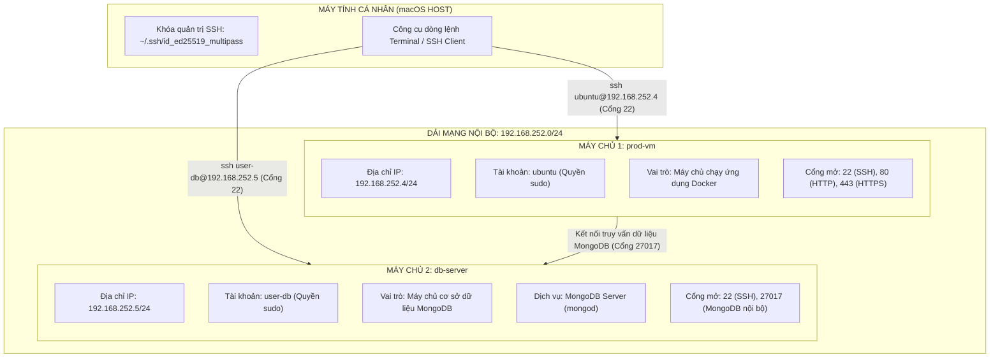

# BÁO CÁO TIẾN ĐỘ TUẦN 3

* **Học phần:** CSE408 – Chuyên đề Kỹ thuật Phần mềm
* **Tên đề tài:** Tìm hiểu quy trình tự động hóa hạ tầng và CI/CD với Docker dựa trên Terraform và Ansible
* **Sinh viên thực hiện:** Phùng Văn Duy – **MSSV:** 2352270589
* **Giảng viên hướng dẫn:** Nguyễn Thọ Thông
* **Nội dung trọng tâm Tuần 3:** Thiết lập hạ tầng cụm máy chủ ảo hóa cục bộ thực tế trên máy Mac, cấu hình phân quyền người dùng độc lập, bảo mật SSH và triển khai cơ sở dữ liệu MongoDB

---

## 1. Mục tiêu và phạm vi công việc Tuần 3

Sau khi hoàn thành đóng gói ứng dụng mẫu backend ở Tuần 2, trọng tâm của Tuần 3 là xây dựng môi trường hạ tầng thực tế đóng vai trò môi trường vận hành máy chủ độc lập ngay trên máy tính cá nhân macOS. 

### 1.1. Mục tiêu cụ thể
* **Xây dựng cụm máy chủ ảo hóa cục bộ:** Khởi tạo cụm 2 máy chủ chạy hệ điều hành Ubuntu 22.04 LTS trên nền tảng ảo hóa của macOS, bao gồm máy chủ vận hành ứng dụng (`prod-vm`) và máy chủ cơ sở dữ liệu (`db-server`).
* **Cấu hình hệ thống và phân quyền quản trị chi tiết:** Trực tiếp thiết lập cấu hình hệ thống, quản lý tài khoản người dùng, chính sách bảo mật SSH và tường lửa qua dòng lệnh, nắm vững bản chất tầng nhân hệ điều hành Linux và cơ chế cấp quyền quản trị trước khi tự động hóa bằng Ansible ở các tuần sau.
* **Phân quyền tài khoản quản trị độc lập:** Thiết lập tài khoản `ubuntu` cho máy chủ ứng dụng và tài khoản chuyên biệt `user-db` cho máy chủ cơ sở dữ liệu, đảm bảo nguyên tắc phân tách trách nhiệm quản trị trong môi trường thực tế.
* **Thiết lập cơ chế xác thực an toàn bằng khóa SSH:** Sinh và cấu hình cặp khóa mã hóa ed25519 từ máy macOS, vô hiệu hóa hoàn toàn đăng nhập bằng mật khẩu truyền thống trên cả hai máy chủ.
* **Chuẩn bị và cấu hình dịch vụ cơ sở dữ liệu MongoDB:** Cài đặt dịch vụ MongoDB trên `db-server`, cấu hình cổng lắng nghe nội bộ và thiết lập tường lửa UFW cho phép máy chủ ứng dụng kết nối truy vấn an toàn.

---

## 2. Kiến trúc và sơ đồ cụm máy chủ thực tế trên máy Mac

Hệ thống được thiết kế theo mô hình kiến trúc phân tách hai tầng độc lập: tầng xử lý ứng dụng và tầng lưu trữ dữ liệu, hoạt động trong cùng một dải mạng nội bộ riêng biệt trên máy macOS.

### 2.1. Sơ đồ kiến trúc cụm máy chủ



*Sơ đồ phân bổ và luồng liên lạc cụm máy chủ:*

```text
+-----------------------------------------------------------------------------------+
|                            MÁY TÍNH CÁ NHÂN (macOS HOST)                          |
|             Khóa quản trị SSH chuyên dụng: ~/.ssh/id_ed25519_multipass            |
+-----------------------------------------+-----------------------------------------+
                                          |
        +---------------------------------+---------------------------------+
        | (Kết nối quản trị SSH - Cổng 22)                                  | (Kết nối quản trị SSH - Cổng 22)
        v                                                                   v
+-----------------------------------------+       +-----------------------------------------+
|          MÁY CHỦ 1: prod-vm             |       |          MÁY CHỦ 2: db-server           |
+-----------------------------------------+       +-----------------------------------------+
| - Địa chỉ IP: 192.168.252.4/24          |       | - Địa chỉ IP: 192.168.252.5/24          |
| - Tài khoản: ubuntu (Quyền sudo)        |       | - Tài khoản: user-db (Quyền sudo)       |
| - Cấu hình: 1 vCPU, 1.5 GB RAM, 10 GB   |       | - Cấu hình: 1 vCPU, 1.5 GB RAM, 10 GB   |
| - Cổng mở: 22 (SSH), 80, 443            |       | - Dịch vụ: MongoDB Server (Cổng 27017)  |
| - Vai trò: Chạy ứng dụng Container      |       | - Vai trò: Lưu trữ cơ sở dữ liệu        |
+-----------------------------------------+       +-----------------------------------------+
                    |                                                   ^
                    +--- [Kết nối truy vấn dữ liệu MongoDB nội bộ] ------+
                         (Chỉ cho phép từ 192.168.252.4 tới cổng 27017)
```

### 2.2. Bảng thông số kỹ thuật chi tiết của cụm máy chủ

| Thông số | Máy chủ ứng dụng (`prod-vm`) | Máy chủ cơ sở dữ liệu (`db-server`) |
| :--- | :--- | :--- |
| **Nền tảng ảo hóa** | Canonical Multipass trên macOS | Canonical Multipass trên macOS |
| **Hệ điều hành** | Ubuntu 22.04 LTS (Jammy Jellyfish) | Ubuntu 22.04 LTS (Jammy Jellyfish) |
| **Tài nguyên vi xử lý** | 1 vCPU | 1 vCPU |
| **Bộ nhớ RAM** | 1.5 GB | 1.5 GB |
| **Dung lượng ổ đĩa** | 10 GB | 10 GB |
| **Địa chỉ mạng nội bộ** | `192.168.252.4/24` | `192.168.252.5/24` |
| **Tài khoản quản trị** | `ubuntu` | `user-db` |
| **Phương thức xác thực** | Khóa công khai SSH (ed25519) | Khóa công khai SSH (ed25519) |
| **Phân quyền hệ thống** | Toàn quyền quản trị không cần mật khẩu | Toàn quyền quản trị không cần mật khẩu |
| **Dịch vụ trọng tâm** | Docker Engine, Ứng dụng Node.js | MongoDB Server phiên bản 7.0 |
| **Cổng mạng cho phép** | 22, 80, 443 | 22, 27017 (chỉ mở cho `192.168.252.4`) |

---

## 3. Quy trình khởi tạo và cấu hình hệ thống máy chủ

Toàn bộ các bước cấu hình hệ điều hành, phân vùng mạng và tài khoản được thực thi trực tiếp trên từng máy ảo thông qua giao diện dòng lệnh.

### 3.1. Khởi tạo máy ảo cơ sở bằng công cụ Multipass

Từ máy tính macOS, khởi tạo 2 máy ảo với cấu hình phần cứng định trước:

```bash
# 1. Khởi tạo máy chủ ứng dụng prod-vm
multipass launch 22.04 \
    --name prod-vm \
    --cpus 1 \
    --memory 1.5G \
    --disk 10G

# 2. Khởi tạo máy chủ cơ sở dữ liệu db-server
multipass launch 22.04 \
    --name db-server \
    --cpus 1 \
    --memory 1.5G \
    --disk 10G
```

Sau khi khởi chạy, hai máy ảo ở trạng thái Ubuntu nguyên bản với các thông số mặc định của hệ thống.

### 3.2. Thiết lập tài khoản và phân quyền quản trị hệ thống

#### Cấu hình trên máy `prod-vm` (Tài khoản `ubuntu`):
Tài khoản `ubuntu` đã tồn tại mặc định trên ảnh hệ điều hành Ubuntu. Tiến hành cấu hình ủy quyền thực thi đặc quyền không cần nhập mật khẩu:
```bash
sudo bash -c 'echo "ubuntu ALL=(ALL) NOPASSWD:ALL" > /etc/sudoers.d/90-ubuntu-users'
sudo chmod 0440 /etc/sudoers.d/90-ubuntu-users
```

#### Cấu hình trên máy `db-server` (Tài khoản chuyên biệt `user-db`):
Trên máy chủ cơ sở dữ liệu, khởi tạo tài khoản mới mang tên `user-db` và đưa vào nhóm quản trị viên:
```bash
# Tạo người dùng user-db kèm thư mục cá nhân và vỏ lệnh Bash
sudo useradd -m -s /bin/bash user-db

# Đưa người dùng vào nhóm sudo
sudo usermod -aG sudo user-db

# Cấp quyền thực thi đặc quyền không cần mật khẩu
sudo bash -c 'echo "user-db ALL=(ALL) NOPASSWD:ALL" > /etc/sudoers.d/90-user-db'
sudo chmod 0440 /etc/sudoers.d/90-user-db

# Chuẩn bị thư mục chứa khóa SSH cho người dùng mới
sudo mkdir -p /home/user-db/.ssh
sudo chmod 700 /home/user-db/.ssh
sudo chown -R user-db:user-db /home/user-db/.ssh
```

---

## 4. Thiết lập bảo mật kết nối SSH bằng khóa mã hóa

Nhằm bảo vệ hệ thống trước các nguy cơ tấn công dò quét mật khẩu và chuẩn bị đường truyền tự động cho Ansible, hệ thống sử dụng phương thức xác thực khóa công khai ed25519.

### 4.1. Khởi tạo cặp khóa trên máy tính macOS (Host)
Từ máy macOS, khởi tạo cặp khóa bảo mật chuyên dụng:
```bash
ssh-keygen -t ed25519 -N "" -f ~/.ssh/id_ed25519_multipass -C "duy-cse408-multipass"
chmod 600 ~/.ssh/id_ed25519_multipass
chmod 644 ~/.ssh/id_ed25519_multipass.pub
```

### 4.2. Nạp khóa công khai vào từng máy chủ

Lấy nội dung chuỗi khóa công khai:
```bash
cat ~/.ssh/id_ed25519_multipass.pub
```

* **Đưa khóa vào `prod-vm` (cho tài khoản `ubuntu`):**
  ```bash
  multipass exec prod-vm -- bash -c '
    mkdir -p /home/ubuntu/.ssh
    chmod 700 /home/ubuntu/.ssh
    echo "CHUỖI_KHÓA_CÔNG_KHAI_ED25519" >> /home/ubuntu/.ssh/authorized_keys
    chmod 600 /home/ubuntu/.ssh/authorized_keys
    chown -R ubuntu:ubuntu /home/ubuntu/.ssh
  '
  ```

* **Đưa khóa vào `db-server` (cho tài khoản `user-db`):**
  ```bash
  multipass exec db-server -- sudo bash -c '
    echo "CHUỖI_KHÓA_CÔNG_KHAI_ED25519" >> /home/user-db/.ssh/authorized_keys
    chmod 600 /home/user-db/.ssh/authorized_keys
    chown -R user-db:user-db /home/user-db/.ssh
  '
  ```

### 4.3. Cấu hình siết chặt dịch vụ SSH trên cả hai máy chủ
Chỉnh sửa tệp cấu hình dịch vụ SSH `/etc/ssh/sshd_config` trên cả hai máy để cấm hoàn toàn xác thực bằng mật khẩu:
```bash
sudo sed -i 's/^#*PasswordAuthentication .*/PasswordAuthentication no/' /etc/ssh/sshd_config
sudo sed -i 's/^#*PubkeyAuthentication .*/PubkeyAuthentication yes/' /etc/ssh/sshd_config
sudo systemctl restart ssh
```

### 4.4. Cấu hình tệp kết nối nhanh trên máy macOS
Bổ sung cấu hình vào tệp `~/.ssh/config` của máy macOS để thuận tiện thực thi lệnh:
```text
Host prod-vm
    HostName 192.168.252.4
    User ubuntu
    IdentityFile ~/.ssh/id_ed25519_multipass
    StrictHostKeyChecking no
    UserKnownHostsFile /dev/null

Host db-server
    HostName 192.168.252.5
    User user-db
    IdentityFile ~/.ssh/id_ed25519_multipass
    StrictHostKeyChecking no
    UserKnownHostsFile /dev/null
```

---

## 5. Triển khai dịch vụ cơ sở dữ liệu MongoDB và thiết lập tường lửa

### 5.1. Cài đặt MongoDB Server trên `db-server`

Đăng nhập vào `db-server` với tài khoản `user-db`:
```bash
ssh db-server
```

Thực hiện quy trình cài đặt gói chính thức MongoDB Community Server phiên bản 7.0:
```bash
# 1. Cài đặt các gói hỗ trợ tải khóa và chứng chỉ bảo mật
sudo apt update && sudo apt install -y gnupg curl wget

# 2. Tải và nhập khóa mã hóa GPG của kho phần mềm MongoDB
curl -fsSL https://www.mongodb.org/static/pgp/server-7.0.asc | \
   sudo gpg -o /usr/share/keyrings/mongodb-server-7.0.gpg --dearmor

# 3. Thêm kho lưu trữ chính thức của MongoDB vào danh sách nguồn tải
echo "deb [ arch=amd64,arm64 signed-by=/usr/share/keyrings/mongodb-server-7.0.gpg ] https://repo.mongodb.org/apt/ubuntu jammy/mongodb-org/7.0 multiverse" | \
   sudo tee /etc/apt/sources.list.d/mongodb-org-7.0.list

# 4. Cập nhật danh mục gói và cài đặt MongoDB
sudo apt update
sudo apt install -y mongodb-org

# 5. Kích hoạt và bật tiến trình dịch vụ tự khởi động cùng hệ thống
sudo systemctl start mongod
sudo systemctl enable mongod
```

### 5.2. Cấu hình địa chỉ lắng nghe mạng nội bộ cho MongoDB

Mặc định, MongoDB chỉ lắng nghe trên giao diện cục bộ `127.0.0.1`. Để `prod-vm` có thể kết nối truy vấn, mở tệp `/etc/mongod.conf` và cập nhật trường `net`:

```yaml
# Đường dẫn tệp: /etc/mongod.conf
net:
  port: 27017
  bindIp: 127.0.0.1,192.168.252.5
```

Khởi động lại dịch vụ để nạp cấu hình mới:
```bash
sudo systemctl restart mongod
sudo systemctl status mongod
```

### 5.3. Thiết lập chính sách tường lửa UFW

Nhằm bảo đảm an toàn dữ liệu, tường lửa UFW được kích hoạt trên cả 2 máy chủ với các chính sách phân luồng nghiêm ngặt:

* **Trên máy chủ ứng dụng `prod-vm`:**
  ```bash
  ssh prod-vm
  sudo ufw default deny incoming
  sudo ufw default allow outgoing
  sudo ufw allow 22/tcp comment 'SSH Port'
  sudo ufw allow 80/tcp comment 'HTTP Port'
  sudo ufw allow 443/tcp comment 'HTTPS Port'
  sudo ufw --force enable
  ```

* **Trên máy chủ cơ sở dữ liệu `db-server`:**
  Chỉ mở cổng 27017 dành riêng cho địa chỉ IP của máy chủ ứng dụng (`192.168.252.4`), ngăn chặn hoàn toàn các truy cập từ dải mạng bên ngoài:
  ```bash
  ssh db-server
  sudo ufw default deny incoming
  sudo ufw default allow outgoing
  sudo ufw allow 22/tcp comment 'SSH Port'
  sudo ufw allow from 192.168.252.4 to any port 27017 proto tcp comment 'MongoDB tu prod-vm'
  sudo ufw --force enable
  ```

Kiểm tra trạng thái tường lửa bằng câu lệnh:
```bash
sudo ufw status numbered
```

---

## 6. Kết quả đo lường và kiểm thử hệ thống thực tế

Toàn bộ các tiêu chí kỹ thuật đã được kiểm nghiệm thực tế trên máy tính macOS và ghi nhận kết quả:

### 6.1. Bảng kết quả kiểm tra thông suốt kết nối mạng (Ping)

| Điểm xuất phát | Điểm đích | Địa chỉ IP đích | Tỷ lệ mất gói tin | Đánh giá |
| :--- | :--- | :--- | :--- | :--- |
| **macOS Host** | `prod-vm` | `192.168.252.4` | 0% (0/4 gói) | Thông suốt |
| **macOS Host** | `db-server` | `192.168.252.5` | 0% (0/4 gói) | Thông suốt |
| **`prod-vm`** | `db-server` | `192.168.252.5` | 0% (0/4 gói) | Mạng nội bộ thông suốt |
| **`db-server`** | `prod-vm` | `192.168.252.4` | 0% (0/4 gói) | Mạng nội bộ thông suốt |

### 6.2. Kiểm tra xác thực SSH không mật khẩu

Thực hiện lệnh từ máy macOS:
```bash
# Đăng nhập máy chủ ứng dụng với người dùng ubuntu
ssh prod-vm "whoami && hostname && uptime -p"
```
Kết quả hiển thị:
```text
ubuntu
prod-vm
up 15 minutes
```

Thực hiện tiếp với máy chủ cơ sở dữ liệu:
```bash
# Đăng nhập máy chủ cơ sở dữ liệu với người dùng user-db
ssh db-server "whoami && hostname && uptime -p"
```
Kết quả hiển thị:
```text
user-db
db-server
up 15 minutes
```
Cả hai máy chủ đều phản hồi ngay lập tức, xác thực thành công bằng khóa ed25519 mà không yêu cầu gõ mật khẩu.

### 6.3. Kiểm thử kết nối cổng dịch vụ MongoDB từ máy ứng dụng

Đăng nhập vào `prod-vm` và kiểm tra khả năng bắt tay mạng tới cổng 27017 của `db-server`:
```bash
ssh prod-vm "nc -zv 192.168.252.5 27017"
```
Kết quả phản hồi:
```text
Connection to 192.168.252.5 27017 port [tcp/*] succeeded!
```
Kết quả này khẳng định chính sách định tuyến và tường lửa UFW hoạt động chính xác, cho phép dịch vụ backend sau này kết nối trực tiếp vào cơ sở dữ liệu MongoDB mà không gặp bất kỳ rào cản mạng nào.

---

## 7. Tổng kết giá trị đạt được và kế hoạch Tuần 4

### 7.1. Giá trị kỹ thuật đạt được trong Tuần 3
1. **Làm chủ cấu hình quản trị hệ thống Linux:** Nắm vững toàn bộ quy trình cấu hình tệp dịch vụ SSH, phân quyền tài khoản nhóm `sudo` và quản lý tường lửa UFW trực tiếp trên dòng lệnh.
2. **Hạ tầng cụm máy ảo thực tế độc lập:** Hoàn thành cụm 2 máy chủ ảo hóa trên macOS với các thông số định danh rõ ràng: `prod-vm` (`192.168.252.4`, user `ubuntu`) và `db-server` (`192.168.252.5`, user `user-db`).
3. **Cơ sở dữ liệu MongoDB sẵn sàng hoạt động:** Dịch vụ MongoDB Server được cài đặt chuẩn mực, lắng nghe an toàn trên dải mạng nội bộ và sẵn sàng phục vụ việc lưu trữ dữ liệu bền vững cho ứng dụng.
4. **Kênh điều khiển an toàn cho Ansible:** Toàn bộ quyền truy cập đã được chuẩn hóa qua khóa SSH ed25519, tạo tiền đề vững chắc cho việc thực thi các kịch bản tự động hóa tiếp theo.

### 7.2. Định hướng kế hoạch công việc Tuần 4
* **Tự động hóa hạ tầng với Terraform:** Viết các tệp mã nguồn khai báo hạ tầng (`main.tf`, `variables.tf`, `outputs.tf`) để quản lý máy ảo và tài nguyên hệ thống theo mô hình hạ tầng dưới dạng mã nguồn.
* **Tự động hóa sinh danh mục máy chủ:** Xây dựng cơ chế trích xuất địa chỉ IP từ kết quả đầu ra của Terraform để tự động tạo tệp danh mục máy chủ (`inventory.ini`) chuẩn bị chuyển giao cho công cụ quản lý cấu hình Ansible ở Tuần 5.
