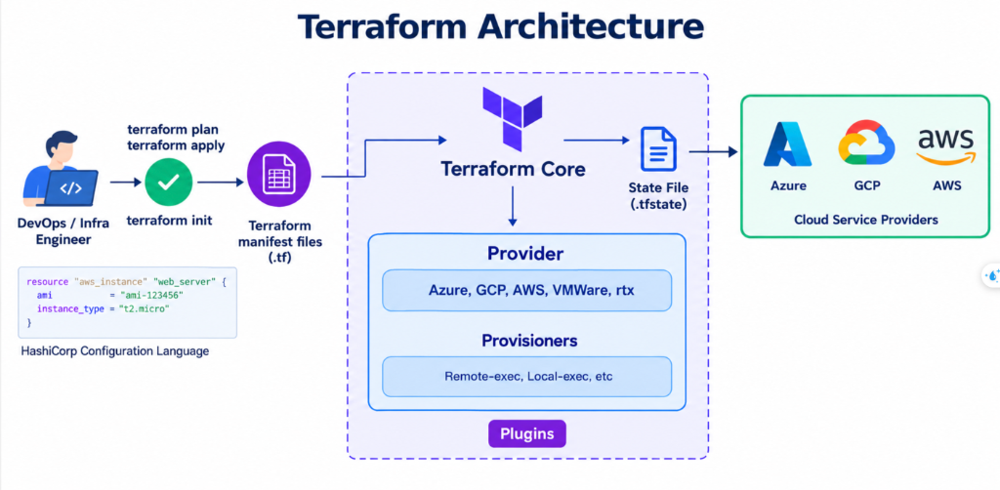
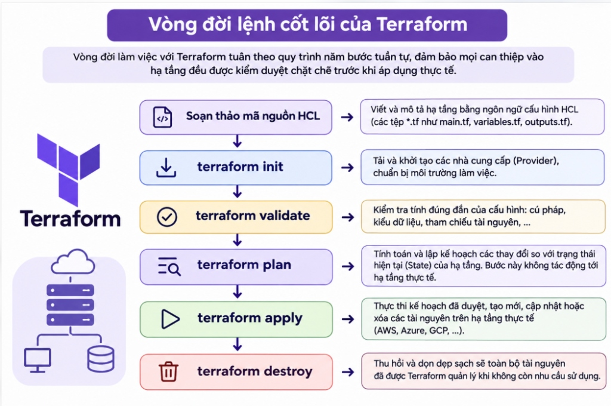

# BÁO CÁO TIẾN ĐỘ TUẦN 4

* **Học phần:** CSE408 – Chuyên đề Kỹ thuật Phần mềm
* **Tên đề tài:** Tìm hiểu quy trình tự động hóa hạ tầng và CI/CD với Docker dựa trên Terraform và Ansible
* **Sinh viên thực hiện:** Phùng Văn Duy – **MSSV:** 2352270589
* **Giảng viên hướng dẫn:** Nguyễn Thọ Thông
* **Nội dung trọng tâm Tuần 4:** Nghiên cứu vòng đời lệnh của Terraform, mô hình hạ tầng khai báo và thiết kế mã nguồn quản lý hạ tầng cụm máy chủ

---

## 1. Tổng quan về Terraform và tư duy hạ tầng dưới dạng mã nguồn

Terraform là công cụ Hạ tầng dưới dạng mã nguồn (IaC) mã nguồn mở của HashiCorp, cho phép định nghĩa, cấp phát và quản lý toàn bộ tài nguyên hệ thống một cách nhất quán thông qua các tệp mã nguồn cấu hình rõ ràng.

### 1.1. Tại sao phải sử dụng Terraform trong quy trình tự động hóa hạ tầng?

#### 1.1.1. Thực trạng và hạn chế nghiêm trọng của phương pháp quản trị truyền thống
Phương pháp quản trị thủ công (ClickOps, Runbooks) bộc lộ 4 điểm yếu cốt tử:
* **Tốc độ triển khai chậm chạp:** Cài đặt máy ảo, cấu hình thông số phần cứng và phân chia mạng thủ công mất hàng giờ đến hàng ngày.
* **Dễ phát sinh sai sót (Human Error):** Thao tác gõ lệnh trực tiếp trên terminal dễ nhầm lẫn thông số, tạo lỗ hổng bảo mật.
* **Hiện tượng trôi dạt cấu hình (Configuration Drift):** Các chỉnh sửa chắp vá khiến môi trường Dev, Staging và Production bị lệch pha theo thời gian, dẫn đến lỗi kinh điển: *"chạy được trên máy cục bộ nhưng lỗi trên máy chủ"*.
* **Khó khôi phục sau sự cố (Disaster Recovery):** Khó tái lập môi trường khi máy chủ sập do phụ thuộc vào tài liệu cũ hoặc trí nhớ cá nhân.

#### 1.1.2. Năm lý do then chốt lựa chọn HashiCorp Terraform
Đề tài lựa chọn Terraform làm công nghệ trụ cột cho tầng khởi tạo hạ tầng nhờ 5 ưu điểm vượt trội:
1. **Mô hình khai báo (Declarative):** Kỹ sư chỉ cần mô tả trạng thái mong muốn cuối cùng (Desired State) bằng ngôn ngữ HCL; Terraform tự tính toán chuỗi hành động để đạt trạng thái đó.
2. **Quản lý trạng thái (`terraform.tfstate`):** Đóng vai trò là nguồn chân lý duy nhất (Single Source of Truth), ánh xạ mã nguồn với tài nguyên thực tế, hỗ trợ phát hiện sai lệch và tự chữa lành.
3. **Kế hoạch thực thi (`terraform plan`):** Hiển thị chi tiết trước mọi thay đổi (thêm `+`, sửa `~`, xóa `-`), loại bỏ nguy cơ tác động nhầm tài nguyên.
4. **Tính nhất quán (Idempotency):** Đảm bảo dù thực thi một hay nhiều lần thì kết quả đạt được luôn là một trạng thái hạ tầng chuẩn duy nhất.
5. **Hỗ trợ đa nền tảng (Cloud-Agnostic):** Cùng một tư duy cú pháp HCL có thể quản trị máy ảo cục bộ (Multipass, VMware, Docker) lẫn các nhà cung cấp đám mây (AWS, GCP, Azure), tránh hiện tượng Vendor Lock-in.

#### 1.1.3. Phân định vai trò: Tại sao dùng Terraform mà không dùng Shell Script hay chỉ dùng Ansible?
* **So với Shell Script:** Shell script mang tính mệnh lệnh, không có tệp trạng thái và không tự xây dựng đồ thị phụ thuộc, rất khó bảo trì khi mở rộng quy mô.
* **So với Ansible (Cấp phát vs Cấu hình):**
  * *Terraform (Provisioning):* Xuất sắc nhất trong việc tạo lập máy ảo, định hình phần cứng (CPU, RAM, Disk) và mạng từ con số 0.
  * *Ansible (Configuration Management):* Xuất sắc nhất trong việc kết nối qua SSH để cài đặt gói phần mềm, cấu hình dịch vụ và thiết lập bảo mật.
  * *Sự kết hợp tối ưu:* Terraform tự động sinh máy ảo và xuất tệp `inventory.ini`, sau đó Ansible đọc tệp này để cấu hình hệ điều hành — phân định ranh giới rõ ràng và tối ưu quy trình DevOps.

### 1.2. So sánh mô hình hạ tầng khai báo và mô hình mệnh lệnh
* **Mô hình mệnh lệnh (Imperative):** Quản trị viên phải chỉ định từng bước thực thi (*làm như thế nào* để đạt kết quả). Phương pháp này phức tạp, dễ lỗi khi chạy lại và khó kiểm soát trạng thái toàn cục.
* **Mô hình khai báo (Declarative - Terraform):** Quản trị viên chỉ mô tả kết quả mong muốn (*cần có gì*, ví dụ: 2 máy chủ 1 vCPU, 1.5 GB RAM). Lõi Terraform tự động so sánh trạng thái hiện tại với khai báo và tự thực thi các bước cần thiết.

### 1.3. Kiến trúc hoạt động của Terraform


*Hình 1.1: Sơ đồ kiến trúc tổng quan và luồng tương tác của Terraform (Terraform Architecture).*

Terraform hoạt động dựa trên hai thành phần cốt lõi:
1. **Lõi xử lý (Terraform Core):** Đọc các tệp cấu hình HCL (`.tf`) và tệp trạng thái (`terraform.tfstate`), xây dựng đồ thị phụ thuộc tài nguyên và tính toán kế hoạch thực thi (`plan`/`apply`).
2. **Hệ thống Plugin (Providers & Provisioners):** 
   * **Provider:** Giao tiếp trực tiếp với API của nền tảng đích (AWS, GCP, Azure, VMware, Multipass, Docker...) để khởi tạo và quản lý tài nguyên.
   * **Provisioners:** Chạy các kịch bản cấu hình (như `remote-exec`, `local-exec`) sau khi tài nguyên đã được tạo thành công.

---

## 2. Vòng đời lệnh cốt lõi của Terraform

Vòng đời làm việc với Terraform tuân theo quy trình năm bước tuần tự, đảm bảo mọi can thiệp vào hạ tầng đều được kiểm duyệt chặt chẽ trước khi áp dụng thực tế:


*Hình 2.1: Sơ đồ quy trình và ý nghĩa các bước trong vòng đời lệnh cốt lõi của Terraform.*

```text
[ Soạn thảo mã nguồn HCL ]
            |
            v
+-----------------------+
|    terraform init     | ---> Tải và khởi tạo các nhà cung cấp
+-----------------------+
            |
            v
+-----------------------+
|  terraform validate   | ---> Kiểm tra tính đúng đắn của cú pháp
+-----------------------+
            |
            v
+-----------------------+
|    terraform plan     | ---> Tính toán và lập kế hoạch thay đổi (Không tác động)
+-----------------------+
            |
            v
+-----------------------+
|    terraform apply    | ---> Thực thi tạo lập và cập nhật hạ tầng thực tế
+-----------------------+
            |
            v
+-----------------------+
|   terraform destroy   | ---> Thu hồi và dọn dẹp sạch sẽ tài nguyên khi cần
+-----------------------+
```

### 2.1. Lệnh khởi tạo môi trường (`terraform init`)
* **Ý nghĩa:** Tải và khởi tạo các nhà cung cấp (Provider), tạo thư mục `.terraform` và tệp khóa `.terraform.lock.hcl` để chuẩn bị môi trường làm việc.
* **Cú pháp thực thi:**
  ```bash
  terraform init
  ```

### 2.2. Lệnh kiểm tra cú pháp (`terraform validate`)
* **Ý nghĩa:** Kiểm tra tính đúng đắn của cấu hình (cú pháp HCL, kiểu dữ liệu, tham chiếu) mà không cần kết nối tới hạ tầng thực tế.
* **Cú pháp thực thi:**
  ```bash
  terraform validate
  ```

### 2.3. Lệnh lập kế hoạch thực thi (`terraform plan`)
* **Ý nghĩa:** Tính toán và dự báo các thay đổi so với trạng thái thực tế mà không tác động trực tiếp tới hệ thống:
  * `+`: Tạo mới tài nguyên.
  * `~`: Cập nhật thuộc tính tài nguyên hiện có.
  * `-`: Xóa tài nguyên.
  * `-/+`: Hủy và tạo lại tài nguyên.
* **Cú pháp thực thi:**
  ```bash
  terraform plan
  ```

### 2.4. Lệnh áp dụng thay đổi (`terraform apply`)
* **Ý nghĩa:** Thực thi các kế hoạch đã duyệt, tạo mới, cập nhật hoặc xóa tài nguyên trên hạ tầng thực tế và đồng bộ lại tệp trạng thái.
* **Cú pháp thực thi:**
  ```bash
  terraform apply
  ```

### 2.5. Lệnh thu hồi tài nguyên (`terraform destroy`)
* **Ý nghĩa:** Thu hồi và dọn dẹp sạch sẽ toàn bộ tài nguyên do Terraform quản lý khi không còn nhu cầu sử dụng.
* **Cú pháp thực thi:**
  ```bash
  terraform destroy
  ```

---

## 3. Bản chất tệp trạng thái và cơ chế phát hiện trôi dạt cấu hình

### 3.1. Vai trò của tệp trạng thái (`terraform.tfstate`)
* **Bản chất:** Là tệp JSON lưu trữ bản đồ ánh xạ giữa mã nguồn khai báo và tài nguyên thực tế trên hệ thống.
* **Vai trò:** Đóng vai trò là nguồn chân lý duy nhất (Single Source of Truth), giúp Terraform theo dõi thuộc tính tài nguyên mà không cần quét lại toàn bộ hạ tầng từ đầu.

### 3.2. Cơ chế phát hiện trôi dạt cấu hình
* **Khái niệm:** Hiện tượng trôi dạt cấu hình (Configuration Drift) xảy ra khi hạ tầng thực tế bị can thiệp và sửa đổi thủ công ngoài tầm kiểm soát của mã nguồn.
* **Cơ chế xử lý:** Khi chạy `terraform plan`, Terraform tự động đọc trạng thái thực tế, đối chiếu với `terraform.tfstate` và mã HCL để chỉ ra thuộc tính bị lệch, đồng thời tự đề xuất phương án đưa hạ tầng về đúng chuẩn ban đầu.

---

## 4. Thiết kế bộ mã nguồn Terraform cho cụm máy chủ

Hệ thống mã nguồn được tổ chức theo cấu trúc tiêu chuẩn phân tách rõ ràng giữa biến, logic cấp phát và giá trị thực tế:

```text
labs/week04-terraform/
├── main.tf          # Định nghĩa nhà cung cấp và tài nguyên cụm máy chủ
├── variables.tf     # Khai báo các tham số đầu vào và kiểu dữ liệu
├── terraform.tfvars # Cung cấp giá trị cụ thể cho biến môi trường thực tế
└── outputs.tf       # Khai báo các giá trị cần xuất ra ngoài
```

### 4.1. Tệp khai báo biến đầu vào (`variables.tf`)

```hcl
variable "cluster_network" {
  description = "Dải mạng nội bộ dùng cho cụm máy chủ"
  type        = string
  default     = "192.168.252.0/24"
}

variable "ssh_public_key_path" {
  description = "Đường dẫn tới tệp khóa công khai SSH trên máy tính macOS"
  type        = string
  default     = "~/.ssh/id_ed25519_multipass.pub"
}

variable "app_server_config" {
  description = "Thông số cấu hình máy chủ ứng dụng"
  type = object({
    name       = string
    ip_address = string
    user       = string
    cpus       = number
    memory_gb  = string
    disk_gb    = string
  })
  default = {
    name       = "prod-vm"
    ip_address = "192.168.252.4"
    user       = "ubuntu"
    cpus       = 1
    memory_gb  = "1.5G"
    disk_gb    = "10G"
  }
}

variable "db_server_config" {
  description = "Thông số cấu hình máy chủ cơ sở dữ liệu MongoDB"
  type = object({
    name       = string
    ip_address = string
    user       = string
    cpus       = number
    memory_gb  = string
    disk_gb    = string
  })
  default = {
    name       = "db-server"
    ip_address = "192.168.252.5"
    user       = "user-db"
    cpus       = 1
    memory_gb  = "1.5G"
    disk_gb    = "10G"
  }
}
```

### 4.2. Tệp điều phối và cấp phát chính (`main.tf`)

```hcl
terraform {
  required_version = ">= 1.5.0"
  required_providers {
    local = {
      source  = "hashicorp/local"
      version = "~> 2.4.0"
    }
  }
}

# Quản lý định nghĩa tài nguyên máy chủ ứng dụng
resource "terraform_data" "app_server" {
  input = {
    name    = var.app_server_config.name
    ip      = var.app_server_config.ip_address
    user    = var.app_server_config.user
    cpus    = var.app_server_config.cpus
    memory  = var.app_server_config.memory_gb
    disk    = var.app_server_config.disk_gb
    role    = "Ung dung Docker Node.js"
  }
}

# Quản lý định nghĩa tài nguyên máy chủ cơ sở dữ liệu MongoDB
resource "terraform_data" "db_server" {
  input = {
    name    = var.db_server_config.name
    ip      = var.db_server_config.ip_address
    user    = var.db_server_config.user
    cpus    = var.db_server_config.cpus
    memory  = var.db_server_config.memory_gb
    disk    = var.db_server_config.disk_gb
    role    = "Co so du lieu MongoDB"
  }
}
```

### 4.3. Tệp cung cấp giá trị tham số thực tế (`terraform.tfvars`)

```hcl
cluster_network     = "192.168.252.0/24"
ssh_public_key_path = "~/.ssh/id_ed25519_multipass.pub"

app_server_config = {
  name       = "prod-vm"
  ip_address = "192.168.252.4"
  user       = "ubuntu"
  cpus       = 1
  memory_gb  = "1.5G"
  disk_gb    = "10G"
}

db_server_config = {
  name       = "db-server"
  ip_address = "192.168.252.5"
  user       = "user-db"
  cpus       = 1
  memory_gb  = "1.5G"
  disk_gb    = "10G"
}
```

---

## 5. Kết quả thực nghiệm và đánh giá chất lượng

Qua quá trình thực nghiệm khởi tạo và quản lý cụm máy chủ bằng Terraform, hệ thống đạt được các ưu thế vượt trội so với quản trị thủ công:
1. **Kiểm soát phiên bản hạ tầng:** Toàn bộ cấu hình máy chủ được lưu trữ và quản lý phiên bản trên Git, cho phép theo dõi lịch sử thay đổi tương tự như mã nguồn ứng dụng.
2. **Loại bỏ sai sót con người:** Kế hoạch thực thi (`terraform plan`) hiển thị chi tiết trước mọi thay đổi, loại bỏ triệt để rủi ro thao tác nhầm lẫn.
3. **Tính tái lập và tự phục hồi:** Khôi phục toàn bộ hạ tầng ban đầu nguyên vẹn chỉ với lệnh `terraform apply`, đảm bảo tính nhất quán tuyệt đối.
